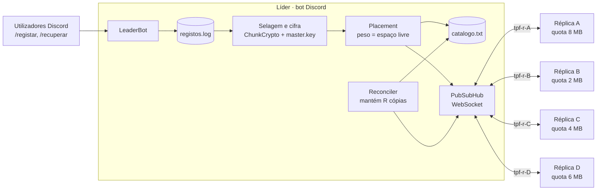
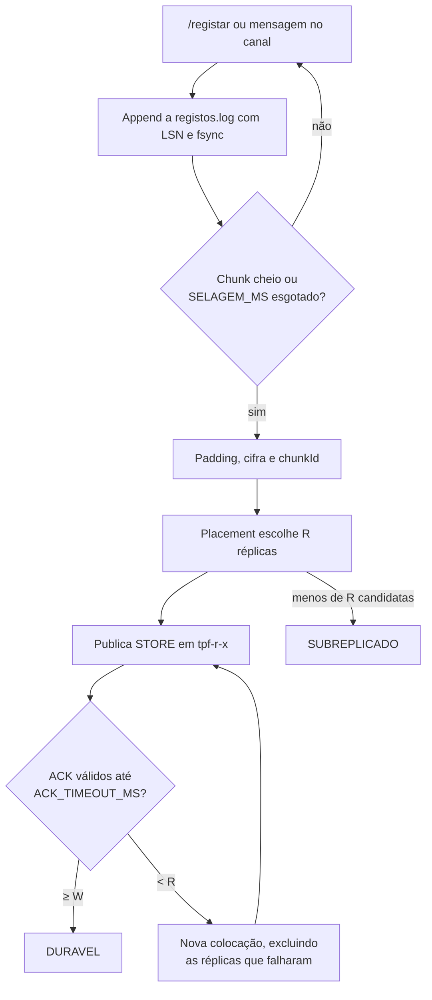
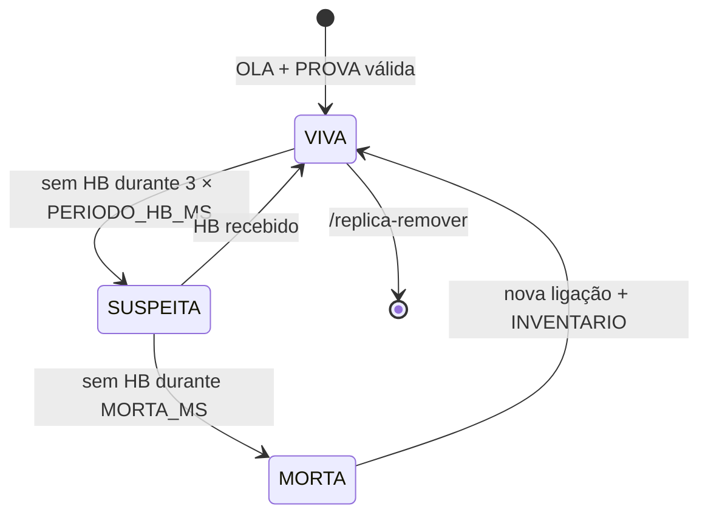
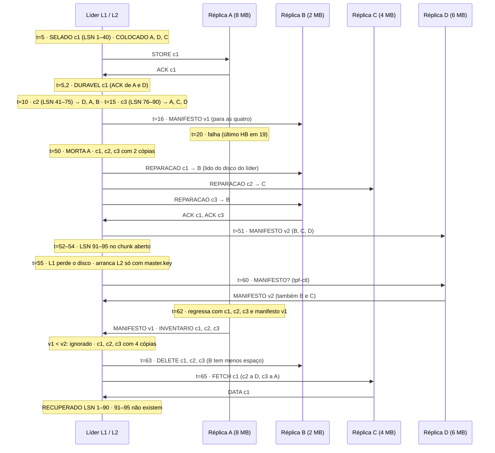
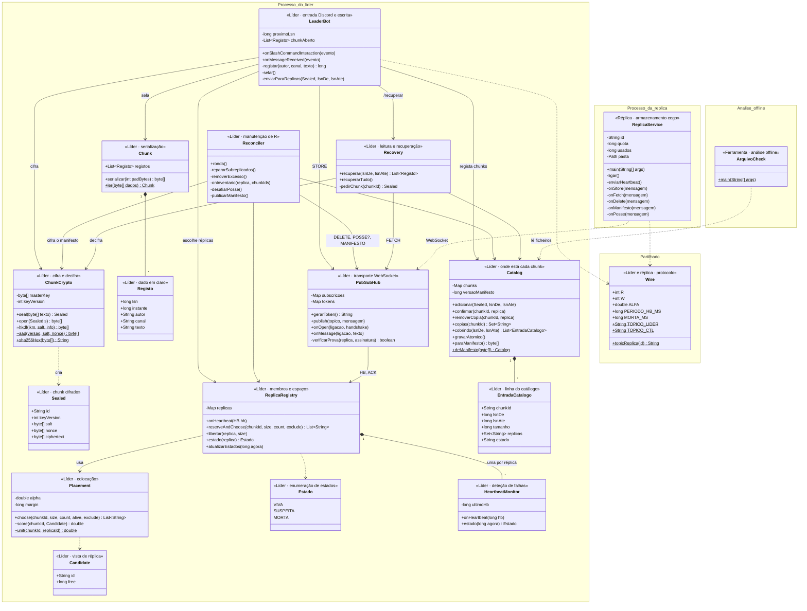

*Sistemas Distribuídos*
# TPF · Arquivo distribuído zero-knowledge

Um **líder (bot Discord)** regista dados num ficheiro e distribui-os por um conjunto **aberto** de máquinas voluntárias, as **réplicas**, que não confiam no líder nem o líder nelas, e cujo espaço em disco é limitado e diferente de máquina para máquina.

A **replicação é parcial**: cada bloco de dados existe em exatamente **R** réplicas, escolhidas de acordo com o **espaço disponível**, pelo que nenhuma réplica tem todos os dados e duas réplicas raramente têm os mesmos. 

A **manutenção dinâmica do fator de replicação**: quando uma réplica falha, entra, sai ou quando R muda, o líder repõe automaticamente R cópias de cada bloco. 

O modelo **zero-knowledge**: tudo o que sai do líder é cifrado com chaves derivadas de uma **master key** que só o líder conhece, pelo que as réplicas guardam, verificam e servem dados que não conseguem ler. O objetivo é compreender de que forma um catálogo, um algoritmo de colocação ponderada e um ciclo de reconciliação permitem **recuperar a totalidade dos dados** a partir de máquinas que, individualmente, só têm fragmentos opacos.

`Replicação parcial` · `Fator de replicação` · `Colocação ponderada` · `Rendezvous hashing` · `Reconciliação` · `Anti-entropia` · `Cifra autenticada` · `HKDF` · `Zero-knowledge` · `Endereçamento por conteúdo` · `Catálogo e manifesto` · `Publish/Subscribe` · `WebSocket`

## Enquadramento

### Ponto de partida

Nas fichas anteriores, todos os nós de uma partição eram **iguais em conteúdo**: o líder publicava lotes e cada seguidor acrescentava-os ao seu ficheiro, pelo que qualquer nó podia servir qualquer registo. Este modelo não escala para o cenário do trabalho final, por três razões:
(1)  as réplicas são máquinas de terceiros com **espaço limitado e desigual**, e copiar tudo para todas desperdiça espaço e falha logo que a menor enche. 
(2) as réplicas **não são de confiança**: quem cede disco não deve conseguir ler o que guarda. 
(3) o conjunto de réplicas é **aberto**: máquinas entram, saem e falham sem aviso, e o número de cópias de cada dado tem de se manter sem intervenção manual.

|  | Fichas anteriores | Trabalho prático final |
| --- | --- | --- |
| Quem atribui a ordem | um líder eleito entre nós iguais | um líder único e fixo, o bot Discord |
| Cópias de cada dado | todos os nós do grupo têm todos os registos | cada chunk existe em R réplicas, escolhidas pelo espaço livre |
| Membros | grupo fixo de três nós | conjunto aberto; réplicas registam-se, saem e falham |
| Unidade replicada | o registo, enviado em lote | o **chunk** selado, cifrado e endereçado pelo seu hash |
| O que a réplica vê | o conteúdo dos registos | bytes opacos e um cabeçalho mínimo |
| Falha de uma cópia | a cópia recupera ao voltar a arrancar | o líder cria uma nova cópia noutra réplica |
| Onde está cada dado | em todos os nós | no **catálogo** do líder, replicado como manifesto cifrado |
| Transporte | publish/subscribe do IPFS e TCP | publish/subscribe sobre WebSocket, com o hub no líder |
| Deteção de falhas | heartbeat do líder | heartbeat de cada réplica, que transporta o espaço livre |

### Componentes e papéis

O sistema tem dois tipos de processos. O **líder** é um bot Discord que recebe registos dos utilizadores, os grava no ficheiro `registos.log`, agrupa-os em chunks, cifra-os e decide para que réplicas vai cada chunk. O líder é também o **hub de publish/subscribe**: aceita ligações WebSocket, mantém as subscrições de cada ligação e encaminha as mensagens publicadas. A **réplica** é um serviço instalado por qualquer máquina interessada em ceder espaço. Liga-se ao líder por WebSocket, subscreve o seu tópico privado e o tópico de controlo, publica heartbeats e guarda os chunks que recebe numa pasta local, até à **quota** que o dono da máquina definiu.



**Figura 1.** Arquitetura. Só o líder conhece a master key e o catálogo; as réplicas comunicam apenas com o hub, nunca entre si.


**Figura 1b.** Os números seguem o percurso de um registo: entra pelo Discord, é selado e cifrado com uma chave derivada da master key, colocado em R réplicas pelo espaço livre e confirmado por `ACK`; o reconciliador e a recuperação usam o mesmo hub para repor cópias e ler chunks.

As ligações são sempre abertas **pela réplica**, o que permite que uma máquina atrás de NAT ou de uma firewall doméstica participe sem abrir portas. Uma réplica regista-se uma única vez com um **token** de uso único gerado pelo comando `/replica-token` no Discord; nesse registo envia uma chave pública Ed25519, que o líder guarda em `replicas.txt`. 

Em cada ligação seguinte, o líder envia um desafio aleatório e a réplica assina-o, o que impede outra máquina de se fazer passar por ela.

### Chunks, cifra e *zero-knowledge*

Replicar registo a registo exigiria uma decisão de colocação, uma mensagem e uma entrada de catálogo por cada linha. Por isso, o líder acumula os registos num **chunk aberto** e **sela-o** quando atinge `CHUNK_MAX_BYTES` ou quando passam `SELAGEM_MS` desde o primeiro registo. Ao selar, o chunk é serializado com os seus registos e os respetivos LSN (número de sequência do log), completado com bytes de **padding** até um múltiplo de `PAD_BYTES` e cifrado. A partir daí, o chunk é imutável.

A master key MK, com 32 bytes, é lida do ficheiro `master.key` e nunca sai do líder. Cada chunk é cifrado com uma chave própria, a DEK, **derivada** da MK, o que dispensa guardar uma chave por chunk:

```
salt      = 32 bytes aleatórios
nonce     = 12 bytes aleatórios
DEK       = HKDF-SHA256(MK, salt, info = "tpf-chunk-v1")
aad       = "tpf-v1" || versaoChave || salt || nonce
cifrado   = AES-256-GCM(DEK, nonce, texto com padding, aad)
chunkId   = SHA-256(cifrado), em hexadecimal
```

**O identificador do chunk é o hash do texto cifrado**, ou seja, o chunk é **endereçado pelo conteúdo**. Isto tem duas consequências. Qualquer réplica pode verificar, sem decifrar, que guarda exatamente os bytes que recebeu. E duas cópias com o mesmo `chunkId` são necessariamente iguais, pelo que uma cópia antiga numa réplica que regressa continua válida. Como o `salt` faz parte da derivação e do `aad`, trocar o cabeçalho de dois chunks faz falhar a autenticação no líder.

| A réplica vê | A réplica não vê |
| --- | --- |
| `chunkId`, `versaoChave`, `salt`, `nonce` | o conteúdo, os autores e os canais dos registos |
| o tamanho do chunk, arredondado a `PAD_BYTES` | os LSN e o número de registos de cada chunk |
| o instante em que recebe cada chunk | que outras réplicas têm o mesmo chunk |
| as mensagens do seu tópico e do tópico de controlo | o catálogo, mesmo guardando o manifesto |

O modelo *zero-knowledge* deste trabalho protege, portanto, o **conteúdo**, mas não esconde o **ritmo** de escrita nem o volume aproximado. Uma réplica que observe que recebe um chunk a cada `SELAGEM_MS` sabe que o bot está ativo, mas não sabe o que foi escrito.

### Escrita e durabilidade

Um registo passa por três estados: **local**, quando está apenas no `registos.log` do líder; **selado**, quando pertence a um chunk cifrado já enviado; e **durável**, quando pelo menos `W` réplicas confirmaram o chunk com um `ACK` cujo hash coincide com o `chunkId`. Só os registos duráveis sobrevivem à perda do disco do líder.



**Figura 2.** Caminho de escrita de um registo até se tornar durável.

### Colocação ponderada pelo espaço livre

Cada réplica *r* reporta em cada heartbeat a sua `quota` e os bytes `usados`. O líder calcula o **espaço livre efetivo** `livre(r) = quota − usados − reservados`, em que `reservados` soma os chunks já enviados a *r* e ainda sem `ACK`. Sem esta reserva, uma rajada de chunks entre dois heartbeats iria toda para a réplica que parecia mais vazia e excederia a sua quota.

Para colocar o chunk *c* de tamanho *s*, o líder considera as réplicas **vivas** com `livre(r) ≥ s + MARGEM_BYTES` e calcula para cada uma a pontuação de **rendezvous hashing ponderado**:

```math
\text{pontuação}(c, r) = \frac{\text{livre}(r)^{\alpha}}{-\ln u(c, r)}, \qquad u(c, r) \in \, ]0, 1[ \text{ derivado de } \mathrm{SHA\text{-}256}(c \,\|\, r)
```

As R réplicas com maior pontuação recebem o chunk. Com α = 1, a probabilidade de uma réplica ser a **primeira** escolhida é proporcional ao seu espaço livre: com 8, 2, 4 e 6 MB livres, A é a primeira em 40 % dos chunks e B em 10 %. Como cada chunk reduz o espaço de quem o recebe, as réplicas tendem a encher **ao mesmo ritmo relativo**, e não ao mesmo ritmo absoluto. O sorteio é determinístico para o mesmo chunk e o mesmo estado, o que facilita a depuração e a reprodução dos ensaios.

### Manutenção dinâmica do fator R

Cada réplica publica um heartbeat a cada `PERIODO_HB_MS`. O líder mantém um estado por réplica, com as transições da Figura 3. A distinção entre `SUSPEITA` e `MORTA` é deliberada: uma réplica que reinicia ou perde a rede durante alguns segundos não deve desencadear a cópia de todos os seus chunks.



**Figura 3.** Estados de uma réplica vistos pelo líder. Só as cópias em réplicas `VIVA` ou `SUSPEITA` contam para R; só em `MORTA` se repara.

Um **reconciliador** corre a cada `RECONCILIACAO_MS` e percorre o catálogo. Para cada chunk conta as cópias **confirmadas** em réplicas que não estão `MORTA`. Se forem menos de R, o chunk é **subreplicado** e entra numa fila de reparação ordenada pelo número de cópias, para que um chunk com uma única cópia seja tratado antes de um com duas. A reparação escolhe novas réplicas com o mesmo algoritmo de colocação, excluindo as que já têm o chunk, e envia-lhes os bytes, lidos do disco do líder ou, se já lá não estiverem, pedidos a uma réplica que os tenha. Se forem mais de R, o chunk tem **cópias em excesso**, e o líder apaga-as das réplicas com **menos** espaço livre. Alterar R com `/config r <n>` não exige nenhum mecanismo próprio: o reconciliador converge para o novo valor.

Quando uma réplica volta a ligar-se, envia o seu `INVENTARIO`. O líder compara-o com o catálogo: chunks que a réplica tem e que fazem falta voltam a contar como cópias; chunks que ninguém referencia, ou que estão em excesso, são apagados. Esta comparação periódica entre o que cada parte julga existir chama-se **anti-entropia**.

### Catálogo, manifesto e recuperação

Como cada réplica tem um subconjunto diferente dos chunks, os dados só são recuperáveis se se souber **onde está cada chunk** e **que registos contém**. Essa informação está no **catálogo** do líder, uma linha por chunk com o `chunkId`, o intervalo de LSN, o tamanho e as réplicas que o confirmaram. O catálogo é, por isso, tão crítico como a master key, e é ele próprio replicado: a cada `MANIFESTO_MS`, ou quando mudou, o líder serializa-o, cifra-o como um chunk, atribui-lhe uma **versão** crescente e envia-o a **todas** as réplicas vivas, que guardam apenas a versão mais recente.

A recuperação de um intervalo de LSN, com o líder a funcionar, consulta o catálogo, pede cada chunk à réplica viva que respondeu mais depressa nos últimos heartbeats, verifica o hash, decifra e ordena os registos. Se o hash ou a autenticação falharem, tenta a réplica seguinte e regista `INTEGRIDADE`. A **recuperação total**, depois de o líder perder o disco, parte apenas da master key e da lista de réplicas registadas: o novo líder pede o manifesto a todas, aceita o de **versão mais alta que autentica** com a MK, pede o inventário a todas para corrigir o que mudou depois dessa versão e reconstrói o `registos.log` a partir dos chunks. Uma réplica não consegue forjar um manifesto, mas pode devolver um **antigo**; escolher o máximo entre todas as respostas, e não a primeira, é o que protege desse ataque.

### Temporização e janelas de risco

Neste trabalho, `PERIODO_HB_MS` = 2000 ms, `MORTA_MS` = 30000 ms, `RECONCILIACAO_MS` = 5000 ms, `SELAGEM_MS` = 5000 ms, `ACK_TIMEOUT_MS` = 4000 ms, `CHUNK_MAX_BYTES` = 65536, `PAD_BYTES` = 4096, `MARGEM_BYTES` = 65536, R = 3, W = 2 e α = 1. Os valores são pequenos para que os ensaios decorram em minutos.

Há duas janelas em que os dados estão mais expostos. A primeira é a **janela de durabilidade**: um registo escrito no instante *t* só fica durável depois de o chunk ser selado e confirmado, no máximo em *t* + `SELAGEM_MS` + `ACK_TIMEOUT_MS` = *t* + 9 s, ignorando o tempo de transmissão. Se o disco do líder se perder nesse intervalo, o registo perde-se. A segunda é a **janela de reparação**: se uma réplica falha em *t*\_f e enviou o último heartbeat em *t*\_hb ∈ \]*t*\_f − 2 s, *t*\_f\], só é declarada `MORTA` entre *t*\_hb + 30 s e *t*\_hb + 35 s, por causa do período do reconciliador. Durante esse tempo, os seus chunks têm apenas R − 1 cópias. Um chunk só se perde se **todas** as suas R réplicas falharem dentro da mesma janela de reparação.

### Formato das mensagens e dos ficheiros

Todas as mensagens são **texto** numa trama WebSocket, com campos separados por `;` e bytes binários em Base64, como nas fichas anteriores. O hub acrescenta apenas duas mensagens de encaminhamento, `SUB;<topico>` e `PUB;<topico>;<mensagem>`.

```
OLA;<replica>;<chavePublica>;<versao>
DESAFIO;<nonce>
PROVA;<replica>;<assinatura>
HB;<replica>;<hb>;<quota>;<usados>;<nChunks>;<versaoManifesto>
STORE;<chunkId>;<versaoChave>;<salt>;<nonce>;<tamanho>;<dados>
ACK;<replica>;<chunkId>;<sha256>
FETCH;<pedido>;<chunkId>
DATA;<replica>;<pedido>;<chunkId>;<versaoChave>;<salt>;<nonce>;<dados>
DELETE;<chunkId>
INVENTARIO?;<pedido>
INVENTARIO;<replica>;<pedido>;<n>;<chunkId>,<chunkId>,...
MANIFESTO;<versao>;<chunkId>;<versaoChave>;<salt>;<nonce>;<dados>
MANIFESTO?;<pedido>
POSSE?;<pedido>;<chunkId>;<inicio>;<comprimento>;<nonce>
POSSE;<replica>;<pedido>;<sha256(nonce || bytes)>
```

| Canal ou ficheiro | Conteúdo |
| --- | --- |
| tópico `tpf-r-<replica>` | `DESAFIO`, `STORE`, `FETCH`, `DELETE`, `INVENTARIO?`, `MANIFESTO`, `MANIFESTO?`, `POSSE?`, dirigidas a uma réplica |
| tópico `tpf-lider` | `OLA`, `PROVA`, `HB`, `ACK`, `DATA`, `INVENTARIO`, `MANIFESTO` e `POSSE` das réplicas |
| tópico `tpf-ctl` | difusão do líder a todas as réplicas: `INVENTARIO?` e `MANIFESTO?` em recuperação |
| `master.key` | 32 bytes, fora do repositório, com permissões só de leitura para o dono |
| `registos.log` | `lsn;instante;autor;canal;texto em Base64`, o log do líder |
| `catalogo.txt` | `chunkId;lsnDe;lsnAte;tamanho;replicas;estado`, reescrito de forma atómica |
| `desafios.txt` | `chunkId;inicio;comprimento;nonce;esperado`, os desafios de posse pré-calculados |
| `replicas.txt` | `replica;chavePublica;quota`, as réplicas registadas |
| `eventos-lider.txt` | `instante;evento;detalhe`, uma linha por evento do líder |
| `dados-<replica>/` | `<chunkId>.bin` e `<chunkId>.hdr`, os chunks guardados pela réplica |
| `eventos-<replica>.txt` | `instante;evento;detalhe`, uma linha por evento da réplica |

Os eventos do líder são `REGISTO`, `SELADO`, `COLOCADO`, `ACK`, `DURAVEL`, `SUBREPLICADO`, `REPARACAO`, `EXCESSO`, `REMOVIDO`, `SUSPEITA`, `MORTA`, `REGRESSO`, `MANIFESTO`, `RECUPERADO`, `INTEGRIDADE`, `POSSE_FALHOU`, `QUOTA` e `ERRO`.

### Exemplo

A figura seguinte representa um líder L1 e quatro réplicas com 8, 2, 4 e 6 MB livres, com R = 3. Os instantes *t* são contados em segundos a partir do arranque. Por legibilidade, só se representa uma das mensagens de cada difusão e omitem-se os heartbeats.



**Figura 4.** Diagrama espaço-tempo da escrita, da falha de uma réplica, da reparação e da recuperação total depois da perda do disco do líder.

| *t* (s) | Catálogo do líder (cópias confirmadas) | Manifesto mais recente | Acontecimento |
| --- | --- | --- | --- |
| 5 | c1: A, D, C | — | c1 durável com os dois primeiros ACK |
| 15 | c1: A, D, C · c2: D, A, B · c3: A, C, D | — | três chunks, cada um com três cópias |
| 16 | igual | v1, nas quatro réplicas | primeiro manifesto |
| 20–49 | igual, mas A em `SUSPEITA` a partir de 25 | v1 | A falhou; as cópias de A ainda contam |
| 50 | c1: D, C · c2: D, B · c3: C, D | v1 | A em `MORTA`; três chunks subreplicados |
| 51 | c1: D, C, B · c2: D, B, C · c3: C, D, B | v2, em B, C e D | R reposto sem intervenção |
| 55 | perdido com o disco de L1 | v2 | LSN 91–95 nunca foram selados |
| 62 | reconstruído de v2 e dos inventários; A volta a contar | v2 | quatro cópias de cada chunk |
| 63 | c1: D, C, A · c2: D, C, A · c3: C, D, A | v3 | excesso removido de B, a réplica com menos espaço |
| 65 | igual | v3 | `registos.log` reconstruído até ao LSN 90 |

Da figura decorrem cinco observações. A réplica B, com apenas 2 MB livres, recebeu só um dos três chunks iniciais, e foi também a primeira a perder as cópias em excesso, porque a colocação e a remoção usam o espaço livre como critério. Entre *t* = 20 e *t* = 50, os chunks de A continuaram a contar como cópias: o sistema troca 30 s de exposição por não reparar a cada reinício de uma máquina. A reparação de *t* = 50 usou os bytes guardados no disco do líder; se L1 já os tivesse apagado, teria pedido c1 a D ou C. A réplica A regressou com um manifesto antigo, que o novo líder ignorou por ter versão inferior, mas com chunks **válidos**: como o identificador é o hash do conteúdo, uma cópia antiga de c1 é exatamente c1. Finalmente, os registos 91 a 95 perderam-se sem deixar vestígio em nenhuma réplica, porque ainda estavam no chunk aberto quando o disco do líder se perdeu, dentro da janela de durabilidade.

## 1 · Objetivos

No final deste trabalho, o aluno deve ser capaz de:

1. **Distinguir** replicação completa de replicação parcial e **justificar** por que razão um sistema com réplicas heterogéneas e não confiáveis precisa de um catálogo para recuperar os dados.
2. **Implementar** um líder que regista, sela, cifra e coloca chunks, um hub de publish/subscribe sobre WebSocket e um serviço de réplica que guarda, verifica e serve chunks que não consegue decifrar.
3. **Aplicar** cifra autenticada com chaves derivadas de uma master key e **demonstrar**, com os ficheiros de uma réplica, que esta não tem acesso ao conteúdo nem consegue alterá-lo sem ser detetada.
4. **Implementar** e **analisar** a colocação ponderada pelo espaço livre, relacionando o parâmetro α com a distribuição da ocupação entre réplicas.
5. **Manter** dinamicamente o fator de replicação R perante falhas, regressos, entradas e alterações de R, e **relacionar** `MORTA_MS` e `RECONCILIACAO_MS` com a janela de reparação.
6. **Recuperar** a totalidade dos registos duráveis a partir apenas da master key e das réplicas, e **medir** o que se perde em cada cenário de falha.
7. **Reconhecer** as limitações que se mantêm: o líder é um ponto único de falha para escritas, a janela de durabilidade expõe os registos recentes e as réplicas observam o ritmo de escrita.

## 2 · Âmbito e pré-requisitos

### 2.1 · Âmbito

Este trabalho trata **exclusivamente** de: o **registo** de dados por um líder único, um bot Discord, num log local; a **selagem** dos registos em chunks e a sua **cifra autenticada** com chaves derivadas de uma master key; um **hub de publish/subscribe** sobre WebSocket alojado no líder; um **serviço de réplica** com quota, autenticação por desafio e verificação de integridade sem decifrar; a **colocação ponderada** pelo espaço livre; a **deteção de falhas** de réplicas por heartbeat; a **manutenção dinâmica** do fator de replicação R; o **catálogo** e a sua replicação como manifesto cifrado; a **recuperação** parcial e total; e a análise *a posteriori* a partir dos ficheiros. Pressupõe **Java 17 ou superior**, uma aplicação Discord de teste com um servidor próprio, e as fichas anteriores concluídas, em particular o detetor de falhas por heartbeat.

São permitidas apenas as bibliotecas seguintes: **JDA** para a API do Discord, **Java-WebSocket** (`org.java-websocket`) para o servidor do hub, o cliente `java.net.http.WebSocket` do JDK nas réplicas e as classes de `javax.crypto` e `java.security` do JDK para cifra, HMAC, hashes e assinaturas Ed25519.

> **Limite explícito:** não se recorre a **eleição ou replicação do líder**, a **códigos de apagamento** (Reed-Solomon ou semelhantes), a **rotação da master key** (`versaoChave` é sempre 1, embora o campo exista), a **comunicação direta entre réplicas**, a **deduplicação** entre chunks, à **ocultação do ritmo de escrita** para além do padding, a **TLS obrigatório** nos ensaios (usa-se `ws://` na máquina local; `wss://` é discutido na reflexão), a **sistemas de armazenamento distribuído** existentes (IPFS, Ceph, MinIO, bases de dados), nem a **bibliotecas de criptografia** fora do JDK. Se uma questão exigir um destes mecanismos para ter resposta completa, a conclusão a retirar é que **a solução deste trabalho não resolve esse problema**. Este limite aplica-se também a qualquer apoio externo utilizado, incluindo assistentes de IA.

### 2.2 · Diagnóstico inicial

Antes de escrever a primeira linha de código, o aluno deve conseguir responder, por palavras suas, aos pontos seguintes:

- **(a)** Há quatro réplicas com quotas de 8, 2, 4 e 6 MB e R = 3. Qual é, no máximo, o volume de dados cifrados que o sistema consegue guardar? Por que razão não é 20 MB / 3, e que papel tem a réplica de 2 MB nesse limite?
- **(b)** Uma réplica guarda um chunk e o respetivo cabeçalho. Que informação consegue extrair? Se alterar um byte do chunk, quem deteta a alteração, quando, e porquê? Se substituir o chunk por outro chunk válido que também guarda, quem deteta?
- **(c)** O líder perde o disco, mas a master key está guardada noutro sítio. Que mais é preciso para recuperar os dados? Se o catálogo não fosse replicado, seria possível recuperar os registos? Em que ordem?

## 3 · Critérios de aceitação

O trabalho é considerado cumprido quando o grupo, perante o seu trabalho, evidencia os quatro pontos seguintes. As *perguntas de verificação* servem igualmente de guião para a avaliação oral.

### `CA1` · Fundamentos

**Define** replicação parcial, fator de replicação, endereçamento por conteúdo, cifra autenticada e *zero-knowledge*, **aplica** estes conceitos ao exemplo da Figura 4 e **explica** por que razão o catálogo, e não as réplicas, é o que torna os dados recuperáveis.

*Perguntas de verificação:*

- No exemplo, se D também tivesse falhado em *t* = 30, algum chunk teria ficado sem cópias antes de *t* = 50? E se a falha de D fosse em *t* = 45, com R = 2?
- Por que razão a cópia de c1 que A trouxe em *t* = 62 é aceite, apesar de A ter estado fora durante a reparação, e o manifesto que A trouxe é ignorado?
- A réplica C guarda o manifesto v3. Que informação sobre os registos consegue obter dele? E sobre as outras réplicas?

### `CA2` · Implementação

**Mostra** no código onde a DEK é derivada e onde o `aad` é construído, onde se calcula o espaço livre efetivo e se reservam bytes, onde se escolhem as réplicas, onde um chunk passa a durável, onde o reconciliador deteta falta e excesso de cópias, e **justifica** as secções sincronizadas entre a *thread* do Discord, a do hub e a do reconciliador.

*Perguntas de verificação:*

- Por que razão o `chunkId` é calculado sobre o texto **cifrado** e não sobre o texto em claro? Que propriedade do *zero-knowledge* se perderia no segundo caso?
- Duas chamadas a `Placement.choose` correm em simultâneo, uma da selagem e outra do reconciliador, e a réplica B tem espaço para apenas um dos dois chunks. Como garante o seu código que B não excede a quota?
- O reconciliador lê o catálogo enquanto um `ACK` o atualiza. Que inconsistência poderia levar a reparar um chunk que já tem R cópias, e que custo teria?

### `CA3` · Análise

**Demonstra**, com `ArquivoCheck`, que nenhum registo durável se perdeu, que todos os chunks terminam com exatamente R cópias confirmadas, a distribuição da ocupação entre réplicas, a duração de cada reparação e o que se perdeu em cada falha do líder, e confirma que nenhum ficheiro de réplica contém texto dos registos.

*Perguntas de verificação:*

- No ensaio 11(b), a ocupação relativa das réplicas convergiu? Que diferença observou entre α = 0, α = 1 e α = 2, e qual explica por que razão a réplica pequena enche primeiro com α = 0?
- As reparações medidas no ensaio 11(c) começaram dentro da janela prevista no Enquadramento? Quanto tempo demorou a repor R depois de declarada `MORTA`, e de que dependeu?
- No ensaio 11(e), quantos registos se perderam? Coincidem com os que estavam no chunk aberto ou à espera de `ACK` quando o líder falhou?

### `CA4` · Limites

**Identifica** pelo menos duas limitações que se mantêm e **esboça** o que seria necessário para as resolver.

*Perguntas de verificação:*

- Enquanto o líder está em baixo, nenhum registo é aceite. Que mecanismo das fichas anteriores permitiria substituí-lo, e que problema novo surge quando o líder substituto também precisa da master key?
- Com R = 3, guardar 1 MB de dados ocupa 3 MB nas réplicas. Que técnica, excluída deste trabalho, toleraria as mesmas falhas com menos espaço, e que custo teria na reparação?
- Uma réplica maliciosa responde a todos os heartbeats e `ACK`, mas apaga os chunks. Como a deteta o desafio de posse, e por que razão os desafios têm de ser pré-calculados pelo líder?

> **Nota:** Um trabalho que produza o resultado correto mas cujos autores não consigam responder aos pontos anteriores **não satisfaz** os critérios de aceitação.

## 4 · Tarefa

Esta secção é a **especificação** do trabalho e **não pode ser alterada nem simplificada**.

### Material de partida

O material de partida é o detetor de falhas por heartbeat das fichas anteriores. Em todo o trabalho:

- crie **dois projetos**, **`tpf-lider`** e **`tpf-replica`**, e coloque todas as classes no pacote **`tpf`**;
- copie a classe **`HeartbeatMonitor`** para `tpf-lider`, adaptando-a para manter um monitor por réplica;
- dê às classes novas os nomes indicados: **`ChunkCrypto`**, **`Placement`**, **`ReplicaRegistry`**, **`Catalog`**, **`PubSubHub`**, **`LeaderBot`**, **`Reconciler`**, **`Recovery`**, **`ReplicaService`** e **`ArquivoCheck`**;
- gere a master key com `head -c 32 /dev/urandom > master.key; chmod 400 master.key` e **nunca** a coloque no repositório; o `.gitignore` deve excluí-la;
- execute o líder e as réplicas **na mesma máquina** nos ensaios, cada réplica com a sua pasta de trabalho, para que os instantes registados sejam comparáveis.

Utiliza-se **R = 3**, **W = 2**, quatro réplicas com quotas de 8, 2, 4 e 6 MB e os parâmetros de temporização do Enquadramento, salvo indicação em contrário. Todos os parâmetros são lidos de propriedades de sistema com o prefixo `tpf.`, por exemplo `-Dtpf.r=3`.

A Figura 5 resume as classes pedidas nos passos seguintes e as dependências entre elas. É um ponto de partida: os atributos e métodos indicados são os que a especificação exige, e cada grupo pode acrescentar outros.



**Figura 5.** Diagrama de classes de partida. Os grupos indicam o processo onde cada classe corre: o processo do líder, o processo de cada réplica e a ferramenta de análise, executada depois dos ensaios; `Wire` é partilhada pelos dois projetos. O estereótipo no topo de cada classe indica o seu papel. `ReplicaService` só depende do hub através do WebSocket: não partilha código com o líder além de `Wire` e das mensagens. Para não sobrecarregar a figura, omitem-se as classes das mensagens, com `encode()` e `decode(String)`, e as dependências de `Wire` a partir das restantes classes do líder.

### 4.1 · Líder: cifra, registo e colocação

1. No projeto `tpf-lider`, crie a classe **`ChunkCrypto`**:

```java
package tpf;

import java.nio.ByteBuffer;
import java.nio.charset.StandardCharsets;
import java.security.GeneralSecurityException;
import java.security.MessageDigest;
import java.security.SecureRandom;
import java.util.HexFormat;
import javax.crypto.Cipher;
import javax.crypto.Mac;
import javax.crypto.spec.GCMParameterSpec;
import javax.crypto.spec.SecretKeySpec;

public final class ChunkCrypto {

    // chunk selado: só estes campos saem do líder
    public static final class Sealed {
        public final String id;          // SHA-256 do texto cifrado, em hexadecimal
        public final int keyVersion;
        public final byte[] salt;
        public final byte[] nonce;
        public final byte[] ciphertext;

        public Sealed(String id, int keyVersion, byte[] salt, byte[] nonce, byte[] ciphertext) {
            this.id = id;
            this.keyVersion = keyVersion;
            this.salt = salt;
            this.nonce = nonce;
            this.ciphertext = ciphertext;
        }
    }

    private static final byte[] INFO = "tpf-chunk-v1".getBytes(StandardCharsets.UTF_8);
    private static final SecureRandom RNG = new SecureRandom();

    private final byte[] masterKey;
    private final int keyVersion;

    public ChunkCrypto(byte[] masterKey, int keyVersion) {
        if (masterKey.length != 32) throw new IllegalArgumentException("a master key deve ter 32 bytes");
        this.masterKey = masterKey.clone();
        this.keyVersion = keyVersion;
    }

    // HKDF-SHA256 (RFC 5869) com saída de 32 bytes, ou seja, um único bloco de expansão
    static byte[] hkdf(byte[] ikm, byte[] salt, byte[] info) throws GeneralSecurityException {
        Mac mac = Mac.getInstance("HmacSHA256");
        mac.init(new SecretKeySpec(salt, "HmacSHA256"));
        byte[] prk = mac.doFinal(ikm);
        mac.init(new SecretKeySpec(prk, "HmacSHA256"));
        mac.update(info);
        mac.update((byte) 0x01);
        return mac.doFinal();
    }

    static byte[] aad(int keyVersion, byte[] salt, byte[] nonce) {
        return ByteBuffer.allocate(6 + 4 + salt.length + nonce.length)
                .put("tpf-v1".getBytes(StandardCharsets.US_ASCII))
                .putInt(keyVersion).put(salt).put(nonce).array();
    }

    public static String sha256Hex(byte[] data) throws GeneralSecurityException {
        return HexFormat.of().formatHex(MessageDigest.getInstance("SHA-256").digest(data));
    }

    public Sealed seal(byte[] plaintext) throws GeneralSecurityException {
        byte[] salt = new byte[32];
        byte[] nonce = new byte[12];
        RNG.nextBytes(salt);
        RNG.nextBytes(nonce);
        byte[] dek = hkdf(masterKey, salt, INFO);
        Cipher c = Cipher.getInstance("AES/GCM/NoPadding");
        c.init(Cipher.ENCRYPT_MODE, new SecretKeySpec(dek, "AES"), new GCMParameterSpec(128, nonce));
        c.updateAAD(aad(keyVersion, salt, nonce));
        byte[] ct = c.doFinal(plaintext);
        return new Sealed(sha256Hex(ct), keyVersion, salt, nonce, ct);
    }

    // lança exceção se o hash não coincidir com o id ou se a autenticação GCM falhar
    public byte[] open(Sealed s) throws GeneralSecurityException {
        if (!sha256Hex(s.ciphertext).equals(s.id))
            throw new GeneralSecurityException("INTEGRIDADE: o hash difere de " + s.id);
        if (s.keyVersion != keyVersion)
            throw new GeneralSecurityException("versao de chave desconhecida: " + s.keyVersion);
        byte[] dek = hkdf(masterKey, s.salt, INFO);
        Cipher c = Cipher.getInstance("AES/GCM/NoPadding");
        c.init(Cipher.DECRYPT_MODE, new SecretKeySpec(dek, "AES"), new GCMParameterSpec(128, s.nonce));
        c.updateAAD(aad(s.keyVersion, s.salt, s.nonce));
        return c.doFinal(s.ciphertext);   // AEADBadTagException se algo foi alterado
    }
}
```

> **Antes de avançar:** o `nonce` é aleatório com 12 bytes. Por que razão, nesta classe, a probabilidade de repetir um par (chave, nonce) é desprezável, ao contrário do que aconteceria se todos os chunks fossem cifrados diretamente com a MK? Que ataque concreto permitiria um par repetido em AES-GCM? Por que razão o `salt` entra no `aad`, se já entra na derivação da DEK? O que deixaria de ser detetado se `open` não verificasse o hash antes de decifrar?

2. Crie a classe **`Chunk`**, que serializa uma lista de registos `(lsn, instante, autor, canal, texto)` e acrescenta padding até um múltiplo de `PAD_BYTES`, e o método inverso, que ignora o padding. Crie a classe **`Wire`** com os parâmetros do Enquadramento, lidos das propriedades `tpf.r`, `tpf.w`, `tpf.alfa`, `tpf.periodo`, `tpf.morta`, `tpf.reconciliacao`, `tpf.selagem`, `tpf.ackTimeout`, `tpf.chunkMax`, `tpf.pad`, `tpf.margem` e `tpf.manifesto`, e os métodos `topicReplica(id)`, que devolve `tpf-r-<id>`, `TOPICO_LIDER` e `TOPICO_CTL`. Para cada mensagem do Enquadramento, crie os métodos `encode()` e `decode(String)`.
3. Crie a classe **`PubSubHub`**, um servidor `org.java_websocket.server.WebSocketServer` no porto `tpf.porto` (por omissão 8765), com as regras seguintes:
   - uma ligação nova só pode enviar `OLA`; o hub responde-lhe diretamente com `DESAFIO` e só depois de uma `PROVA` válida a ligação pode subscrever `tpf-r-<id>`, e apenas o tópico com o seu próprio identificador, e `tpf-ctl`;
   - no **primeiro registo**, a réplica acrescenta `;<token>` ao `OLA`; o hub aceita a chave pública se o token tiver sido gerado por `/replica-token`, ainda não tiver sido usado e tiver menos de 10 minutos, e grava a réplica em `replicas.txt`;
   - as mensagens publicadas pelas réplicas em `tpf-lider` são entregues ao líder no mesmo processo, sem passar pela rede; o líder publica em `tpf-r-<id>` e `tpf-ctl` através do mesmo hub;
   - uma réplica que tente publicar no tópico de outra réplica, ou subscrevê-lo, é desligada e o evento `ERRO` é registado.

> **Antes de avançar:** o desafio tem de ser um nonce novo em cada ligação. Que ataque seria possível se fosse sempre o mesmo? Por que razão um token de registo de uso único e com validade curta é preferível a uma palavra-passe partilhada por todas as réplicas?

4. Crie a classe **`LeaderBot`**, com JDA, que trata os comandos `/registar <texto>`, `/estado`, `/config r <n>`, `/recuperar <de> <ate>`, `/replica-token` e `/replica-remover <id>`, e regista também todas as mensagens enviadas ao canal `#arquivo`. Cada registo recebe o LSN seguinte, é acrescentado a `registos.log` com `fsync` antes de o bot responder ao utilizador e entra no chunk aberto. Um `ScheduledExecutorService` sela o chunk aberto quando passam `SELAGEM_MS` desde o primeiro registo; o registo que faz o chunk exceder `CHUNK_MAX_BYTES` sela-o de imediato. Os comandos de configuração e de réplicas só são aceites de membros com o papel `admin-arquivo`, e `/estado` mostra, por réplica, o estado, a ocupação e o número de chunks, e o número de chunks subreplicados.
5. Crie a classe **`Placement`**:

```java
package tpf;

import java.nio.charset.StandardCharsets;
import java.security.MessageDigest;
import java.security.NoSuchAlgorithmException;
import java.util.ArrayList;
import java.util.Collection;
import java.util.Comparator;
import java.util.List;
import java.util.Set;

public final class Placement {

    // vista de uma réplica no instante da decisão
    public static final class Candidate {
        public final String id;
        public final long free;          // quota − usados − reservados, em bytes

        public Candidate(String id, long free) {
            this.id = id;
            this.free = free;
        }
    }

    private final double alpha;
    private final long margin;

    public Placement(double alpha, long margin) {
        this.alpha = alpha;
        this.margin = margin;
    }

    // u(c, r) uniforme em ]0, 1[, a partir dos primeiros 53 bits de SHA-256(c | r)
    static double unit(String chunkId, String replicaId) {
        try {
            byte[] h = MessageDigest.getInstance("SHA-256")
                    .digest((chunkId + "|" + replicaId).getBytes(StandardCharsets.UTF_8));
            long v = 0;
            for (int i = 0; i < 8; i++) v = (v << 8) | (h[i] & 0xff);
            v >>>= 11;
            return (v + 0.5) / (double) (1L << 53);
        } catch (NoSuchAlgorithmException e) {
            throw new IllegalStateException(e);
        }
    }

    double score(String chunkId, Candidate c) {
        return Math.pow((double) c.free, alpha) / -Math.log(unit(chunkId, c.id));
    }

    // devolve até 'count' réplicas, por ordem decrescente de pontuação; pode devolver menos
    public List<String> choose(String chunkId, long size, int count,
                               Collection<Candidate> alive, Set<String> exclude) {
        List<Candidate> ok = new ArrayList<>();
        for (Candidate c : alive)
            if (!exclude.contains(c.id) && c.free >= size + margin) ok.add(c);
        ok.sort(Comparator.comparingDouble((Candidate c) -> score(chunkId, c)).reversed());
        List<String> out = new ArrayList<>();
        for (int i = 0; i < Math.min(count, ok.size()); i++) out.add(ok.get(i).id);
        return out;
    }
}
```

Crie a classe **`ReplicaRegistry`**, que mantém por réplica o estado (`VIVA`, `SUSPEITA`, `MORTA`), a quota, os bytes usados reportados, os bytes reservados e o instante do último heartbeat. O método `reserveAndChoose(chunkId, size, count, exclude)` constrói os candidatos a partir das réplicas que não estão `MORTA`, chama `Placement.choose` e soma `size` aos reservados de cada réplica escolhida, **na mesma secção sincronizada**. Um `ACK` ou o fim do prazo `ACK_TIMEOUT_MS` libertam a reserva.

> **Antes de avançar:** com α = 1, mostre que a probabilidade de uma réplica ser a primeira escolhida é proporcional ao seu espaço livre. Por que razão a ordenação usa uma pontuação por par (chunk, réplica), e não apenas o espaço livre? O que aconteceria à distribuição se as réplicas `SUSPEITA` fossem excluídas dos candidatos? E se não houvesse reserva e chegassem dez chunks entre dois heartbeats?

6. Implemente a **escrita**. Ao selar um chunk, o líder cifra-o, grava os bytes cifrados em `selados/<chunkId>.bin`, pré-calcula 8 desafios de posse, cada um sobre um intervalo aleatório de 1 KB, e grava-os em `desafios.txt`, acrescenta o chunk ao catálogo com estado `SELADO` e chama `reserveAndChoose` com `count` = R. Se forem devolvidas menos de R réplicas, regista `SUBREPLICADO` e envia às que houver. Publica `STORE` em cada tópico escolhido e espera pelos `ACK`. Um `ACK` só é aceite se o hash coincidir com o `chunkId`; nesse caso, a réplica é acrescentada ao chunk no catálogo. Com W confirmações, o chunk passa a `DURAVEL`. Se ao fim de `ACK_TIMEOUT_MS` faltarem confirmações, chama de novo `reserveAndChoose`, excluindo as réplicas já tentadas, até um máximo de três rondas. O catálogo é reescrito de forma atómica, com um ficheiro temporário e `ATOMIC_MOVE`, sempre que muda.

### 4.2 · Serviço de réplica

7. No projeto `tpf-replica`, crie a classe **`ReplicaService`**, executada como `ReplicaService <id> <url> <quotaBytes> [token]`. No arranque, o serviço:
   - lê ou gera o seu par de chaves Ed25519 em `dados-<id>/chave.der` e determina os bytes usados somando os ficheiros `.bin` da sua pasta;
   - liga-se ao hub com `java.net.http.WebSocket`, envia `OLA` (com o token, se for o primeiro registo), responde ao `DESAFIO` com `PROVA` e subscreve `tpf-r-<id>` e `tpf-ctl`;
   - publica `HB` em `tpf-lider` a cada `PERIODO_HB_MS`, e envia o seu `INVENTARIO` completo depois de cada ligação;
   - se a ligação cair, volta a ligar-se com espera exponencial, de 1 s até 30 s.

   Por cada mensagem recebida, o serviço:
   - `STORE`: recusa e regista `QUOTA` se `usados + tamanho > quota`; caso contrário, calcula o SHA-256 dos dados, recusa se diferir do `chunkId`, grava `<chunkId>.bin` e `<chunkId>.hdr` através de um ficheiro temporário e `ATOMIC_MOVE`, e só depois publica `ACK`;
   - `FETCH`: lê o chunk, verifica o hash e publica `DATA`; se o hash não coincidir, apaga o chunk e não responde;
   - `DELETE`: apaga o chunk e atualiza os usados;
   - `MANIFESTO`: guarda-o como `manifesto.bin` se a versão for superior à que tem; `MANIFESTO?`: responde com o que tem;
   - `POSSE?`: responde `POSSE` com o SHA-256 do nonce seguido dos bytes pedidos.

   A réplica escreve todos os eventos em `eventos-<id>.txt` e **nunca** recebe nem guarda a master key, o catálogo em claro ou registos em claro.

> **Antes de avançar:** por que razão a réplica grava o chunk antes de publicar `ACK`, e não depois? Que sequência de falhas faria o líder considerar durável um chunk que nenhuma réplica tem? Por que razão a réplica verifica o hash no `FETCH`, se o líder também o verifica ao receber `DATA`?

### 4.3 · Manutenção e recuperação

8. Crie a classe **`Reconciler`**, que corre a cada `RECONCILIACAO_MS` e:
   - atualiza o estado de cada réplica: `SUSPEITA` sem heartbeat durante 3 × `PERIODO_HB_MS`, `MORTA` sem heartbeat durante `MORTA_MS`, `VIVA` ao receber um heartbeat, registando `SUSPEITA`, `MORTA` e `REGRESSO`;
   - para cada chunk, conta as cópias confirmadas em réplicas que não estão `MORTA`; se forem menos de R, coloca-o numa fila de prioridade pelo número de cópias e regista `SUBREPLICADO`; se forem mais de R, envia `DELETE` às réplicas com menos espaço livre até restarem R e regista `EXCESSO` e `REMOVIDO`;
   - repara no máximo `tpf.reparacoes` chunks por ronda (por omissão 20), escolhendo os destinos com `reserveAndChoose` e excluindo as réplicas que já têm o chunk; os bytes vêm de `selados/` ou, se já lá não estiverem, de um `FETCH` a uma réplica viva; regista `REPARACAO` com o chunk, a origem e o destino;
   - ao receber um `INVENTARIO`, acrescenta ao catálogo as cópias de chunks conhecidos que não estavam registadas e envia `DELETE` dos chunks que o catálogo não conhece;
   - a cada ronda, envia um `POSSE?` com um desafio ainda não usado a uma réplica escolhida ao acaso para um chunk ao acaso; se a resposta falhar ou não chegar em `ACK_TIMEOUT_MS`, regista `POSSE_FALHOU` e retira essa cópia do catálogo;
   - a cada `MANIFESTO_MS`, se o catálogo mudou, cifra-o com `ChunkCrypto`, incrementa a versão e envia `MANIFESTO` a todas as réplicas vivas, registando `MANIFESTO`.

> **Antes de avançar:** por que razão uma cópia numa réplica `SUSPEITA` continua a contar para R? Que custo teria contar só as `VIVA`, num sistema em que as réplicas são portáteis de alunos? Por que razão as cópias em excesso são removidas das réplicas com menos espaço, e não das que as receberam mais recentemente?

9. Crie a classe **`Recovery`** com duas operações. `recuperar(de, ate)`, usada por `/recuperar`, determina pelo catálogo os chunks que cobrem o intervalo, pede cada um à réplica viva com menor tempo de resposta nos últimos heartbeats, decifra-o e devolve os registos por ordem de LSN; se o hash ou a autenticação falharem, regista `INTEGRIDADE` e tenta a réplica seguinte. `recuperarTudo()`, executada quando o líder arranca sem `catalogo.txt` mas com `master.key` e `replicas.txt`, publica `MANIFESTO?` em `tpf-ctl`, espera `tpf.esperaManifesto` ms (por omissão 10000), aceita a versão mais alta que autentica, publica `INVENTARIO?`, reconstrói o catálogo, obtém todos os chunks e reescreve `registos.log`, registando `RECUPERADO` com o intervalo de LSN e o número de registos.
10. Crie a classe **`ArquivoCheck`**, executada como `ArquivoCheck <pastaLider> <pastaReplica>... [falhas.txt]`, que lê os ficheiros do líder e das réplicas e escreve um relatório que indica:
    - a **durabilidade**: os LSN de `registos.log` de uma execução de referência que não existem no log final, separando os que nunca foram selados dos que foram selados mas não chegaram a `DURAVEL`;
    - a **replicação final**: para cada chunk, as réplicas que o têm de facto nas suas pastas, comparadas com o catálogo; o número de chunks com menos de R, exatamente R e mais de R cópias;
    - a **ocupação**: por réplica, os bytes usados, a quota e a percentagem, e o desvio-padrão das percentagens;
    - as **reparações**: se for indicado `falhas.txt`, com linhas `<replica>;<instante>`, o instante em que cada réplica foi declarada `MORTA`, o instante do primeiro `REPARACAO` e do último `ACK` correspondente, e o número de chunks reparados;
    - o ***zero-knowledge***: a verificação de que nenhum ficheiro das pastas das réplicas contém, em claro, nenhum texto de mais de 8 caracteres presente em `registos.log`;
    - a **integridade**: os eventos `INTEGRIDADE` e `POSSE_FALHOU`, por réplica.

### 4.4 · Ensaios

Para gerar carga sem depender do ritmo do Discord, o líder aceita o comando de administrador `/rajada <n> <intervaloMs>`, que injeta *n* registos sintéticos pelo mesmo caminho dos registos reais. Antes de cada ensaio, apague `registos.log`, `catalogo.txt`, `selados/` e as pastas `dados-*`, mantendo `master.key` e as chaves das réplicas.

11. Execute os ensaios seguintes, terminando cada um com `ArquivoCheck` e guardando o relatório. Para provocar uma falha, anote o instante e termine o processo sem lhe dar oportunidade de reagir, por exemplo com `echo "A;$(date +%s%3N)" >> falhas.txt; kill -9 <pid>`.
    - **(a)** reproduza a Figura 4: arranque o líder e as quatro réplicas, injete 90 registos em 15 s, termine a réplica A, aguarde a reparação, injete mais 5 registos e termine o líder antes de `SELAGEM_MS`; arranque um novo líder só com `master.key` e `replicas.txt`, volte a arrancar A e confirme a recuperação, a remoção do excesso e a perda dos últimos 5 registos;
    - **(b)** com R = 3 e as quatro réplicas, execute `/rajada 400 50` até surgir o primeiro `SUBREPLICADO`, registando a ocupação de cada réplica a cada 10 s; repita com α = 0, α = 1 e α = 2;
    - **(c)** durante uma `/rajada 300 100`, termine uma réplica, aguarde até R estar reposto e volte a arrancá-la 60 s depois; repita três vezes, terminando de cada vez uma réplica diferente, e registe a janela de reparação, a duração, os chunks reparados e os removidos por excesso;
    - **(d)** com dados guardados, execute `/config r 2`, depois `/config r 4` e depois `/config r 3`; a seguir, acrescente uma réplica E com quota de 10 MB e injete mais 200 registos; registe o tempo de convergência de cada alteração e a parte dos chunks novos que E recebeu;
    - **(e)** durante uma `/rajada 300 100`, termine o líder, apague tudo exceto `master.key` e `replicas.txt` e volte a arrancá-lo; repita depois de substituir, antes do arranque, o `manifesto.bin` de uma réplica por uma cópia antiga guardada no início do ensaio;
    - **(f)** com os processos a correr, altere um byte de um `.bin` da réplica B, troque o conteúdo de dois `.bin` da réplica C e apague três `.bin` da réplica D sem a terminar; execute `/recuperar` para todo o intervalo e aguarde três minutos; registe quem detetou cada alteração, quando, e se algum registo se perdeu.
12. Introduza **deliberadamente** as falhas seguintes, uma de cada vez, repondo o código correto entre elas, e registe o lado onde a falha se manifestou, se `ArquivoCheck` a detetou e a conclusão.

| Falha introduzida | Lado onde surgiu | Detetada por `ArquivoCheck`? | O que permitiu concluir |
| --- | --- | --- | --- |
| Reserva de espaço desativada (`reservados` sempre 0), com `/rajada 200 10` |  |  |  |
| `chunkId` calculado sobre o texto em claro em vez do texto cifrado |  |  |  |
| Réplica que publica `ACK` antes de gravar o chunk, terminada logo após o `ACK` |  |  |  |
| Reconciliador que só conta cópias em réplicas `VIVA`, com uma réplica suspensa 10 s com `kill -STOP` e `kill -CONT` |  |  |  |
| `recuperarTudo` que aceita o primeiro manifesto recebido, repetindo o ensaio 11(e) com o manifesto antigo |  |  |  |
| `nonce` fixo, com 12 bytes a zero, em todos os chunks |  |  |  |

### 4.5 · Comparação e reflexão crítica

13. Preencha as tabelas seguintes com os valores **medidos**. A primeira usa os ensaios 11(a) a 11(d) (média das execuções); a segunda usa os ensaios 11(c), 11(e) e 11(f).

| Métrica | Valor |
| --- | --- |
| Tempo de um registo até `DURAVEL` (médio / máximo, s) |  |
| Volume guardado até ao primeiro `SUBREPLICADO`: α = 0 / 1 / 2 (MB) |  |
| Desvio-padrão da ocupação relativa no fim de 11(b): α = 0 / 1 / 2 (pontos percentuais) |  |
| Início da reparação após a falha de uma réplica (mínimo / médio / máximo, s) |  |
| Duração da reparação, de `MORTA` ao último `ACK` (s) |  |
| Convergência após `/config r` (2 / 4 / 3, s) |  |
| Parte dos chunks novos recebida pela réplica E em 11(d) (%) |  |
| Chunks com número de cópias diferente de R no fim de cada ensaio |  |
| Ocorrências de texto em claro nas pastas das réplicas |  |

| Cenário (ensaio) | Escritas aceites durante a falha? | Menor número de cópias de um chunk | Registos perdidos | Quem detetou e quando | Reposição sem intervenção? |
| --- | --- | --- | --- | --- | --- |
| Falha de uma réplica (c) |  |  |  |  |  |
| Perda do disco do líder (e) |  |  |  |  |  |
| Manifesto antigo numa réplica (e) |  |  |  |  |  |
| Byte alterado (f) |  |  |  |  |  |
| Chunks trocados (f) |  |  |  |  |  |
| Chunks apagados sem falha do processo (f) |  |  |  |  |  |

14. Responda às questões seguintes, fundamentando com os valores medidos sempre que aplicável:
    - **Colocação.** Com base em 11(b), explique por que razão α = 0 esgota primeiro a réplica mais pequena e por que razão α = 1 tende a igualar a ocupação relativa. Que efeito teve α = 2? Que critério, além do espaço, seria razoável considerar, e como o acrescentaria à pontuação sem perder a proporcionalidade?
    - **Fator de replicação.** Com base em 11(c) e 11(d), relacione `MORTA_MS` e `RECONCILIACAO_MS` com a janela de reparação e com o tráfego gerado por reinícios curtos. Com que probabilidade se perderia um chunk se cada réplica tivesse uma probabilidade *p* de falhar dentro de uma janela de reparação, com R = 2 e com R = 3?
    - **Zero-knowledge.** Com base em 11(f) e na sexta falha da tabela, explique o que a cifra autenticada protege e o que não protege. Que informação continua a chegar às réplicas, e que informação passaria a chegar a quem observa a rede sem `wss://`? Por que razão `ArquivoCheck` não detetou o `nonce` fixo, e o que permitiria a quem tivesse dois chunks cifrados com o mesmo nonce?
    - **Catálogo e manifesto.** Com base em 11(e), por que razão o catálogo é tão crítico como a master key? Que registos se perderam e em que estado estavam? O que aconteceria à recuperação se o manifesto só fosse enviado a R réplicas, e não a todas?
    - **Integridade e réplicas maliciosas.** Com base em 11(f), compare a deteção por hash na leitura com a deteção por desafio de posse: qual deteta mais cedo, qual tem custo para o líder, e por que razão os desafios se esgotam? Uma réplica que guarde só o hash de cada chunk consegue passar nos desafios?
    - **O líder único.** Enquanto o líder está em baixo, o sistema não aceita escritas nem consegue servir leituras. Por que razão as leituras também dependem do líder, apesar de os dados estarem nas réplicas? Que mecanismo das fichas anteriores permitiria substituir o líder, e que problema cria partilhar a master key entre vários candidatos?
    - **Limites.** Com R = 3, cada byte útil ocupa três nas réplicas. Descreva como um código de apagamento com *k* fragmentos de dados e *m* de paridade reduziria esse custo, que falhas toleraria e por que razão tornaria a reparação mais cara. Esse mecanismo cabe no âmbito deste trabalho?

---

*Sistemas Distribuídos · ESTGV — Trabalho prático final, sobre replicação parcial com colocação ponderada pelo espaço livre, manutenção dinâmica do fator de replicação, cifra autenticada zero-knowledge e recuperação a partir de réplicas heterogéneas, com um líder Discord e publish/subscribe sobre WebSocket.*